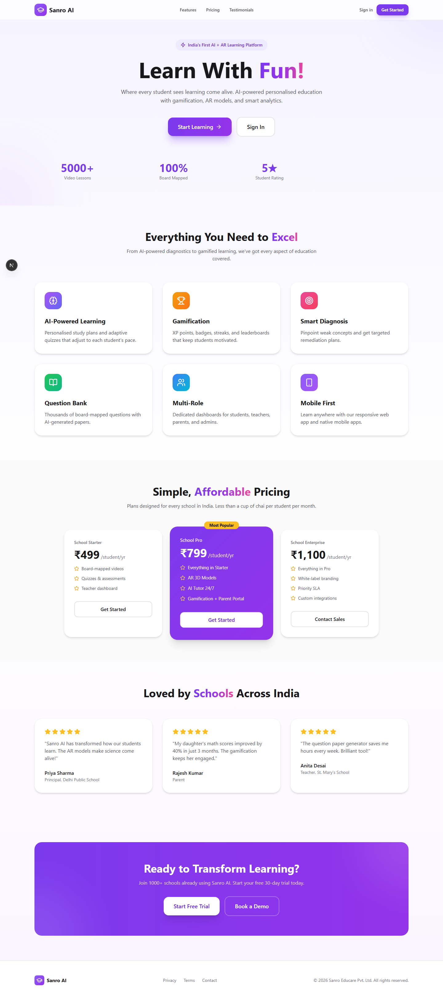
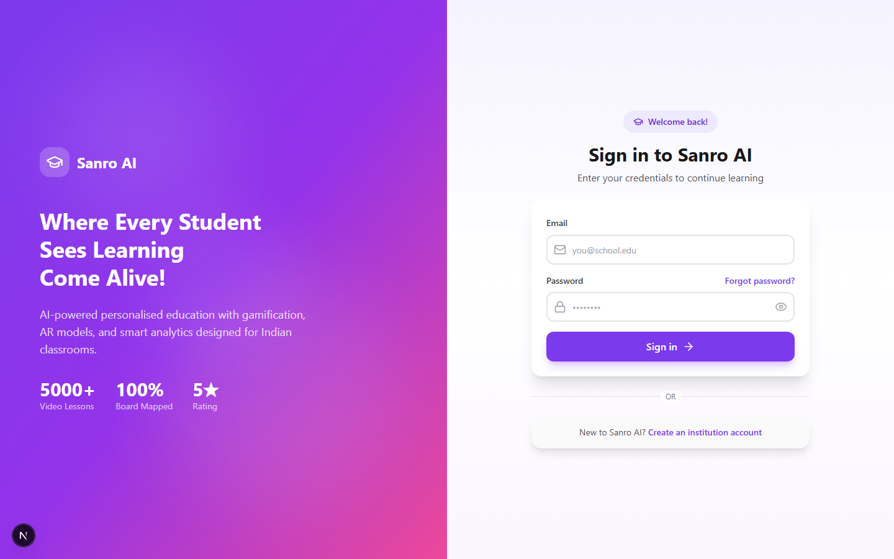
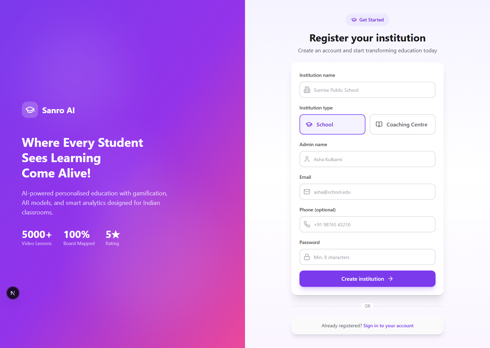
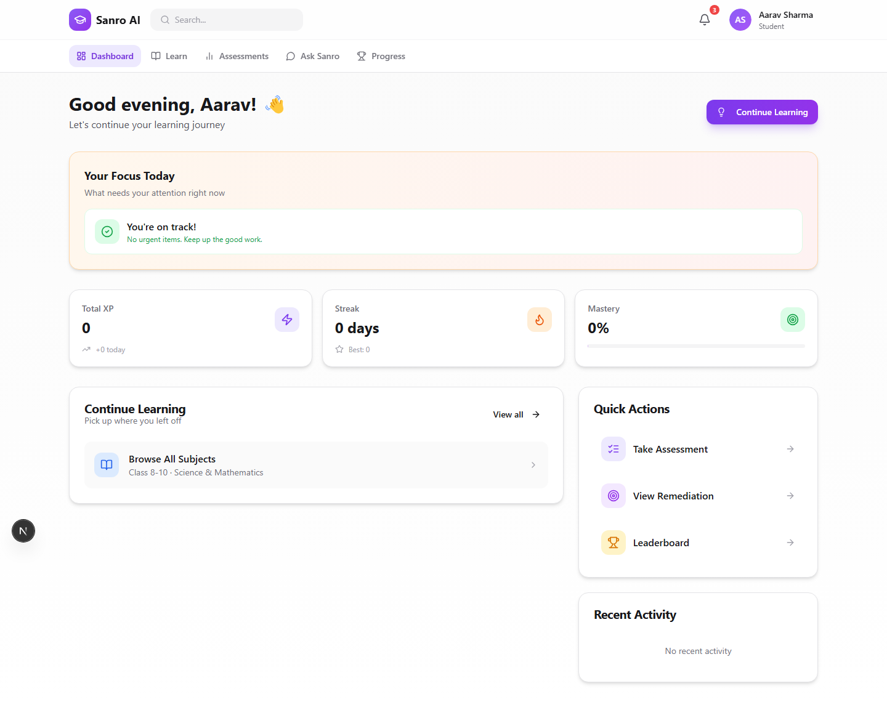
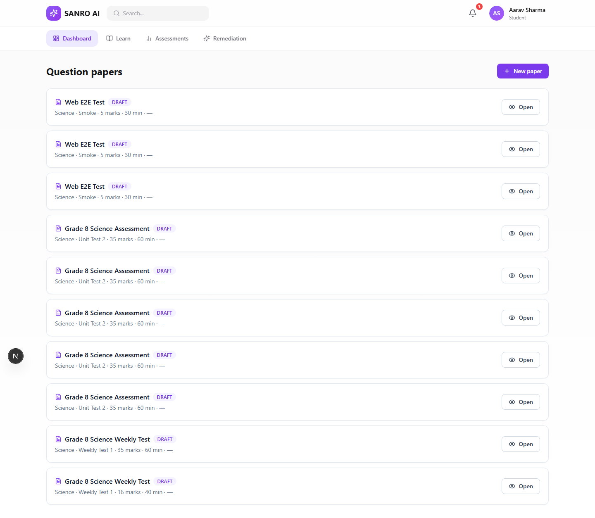
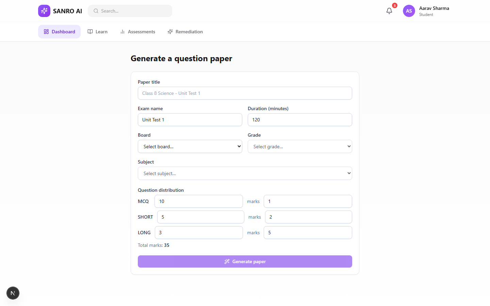
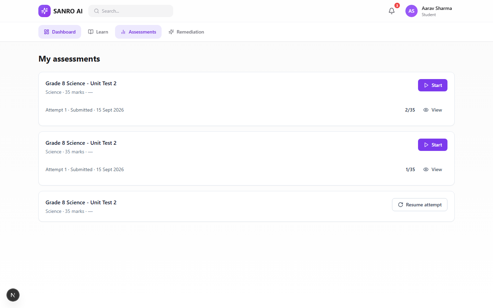
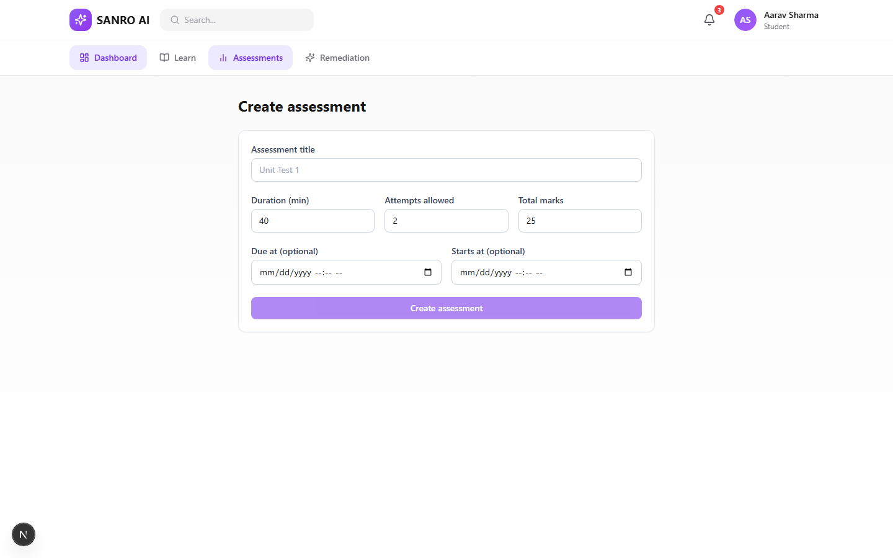
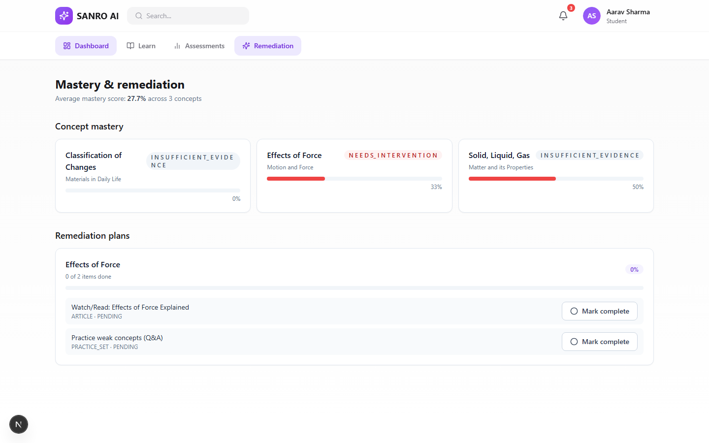

# Sanro AI

> India's first AI + AR learning platform for schools and coaching centres.

**ASSESS → DIAGNOSE → FIX → RETEST → IMPROVE**

Built for CBSE Board, focused on Classes 1–10 Science and Mathematics.

---

## Quick Start

```bash
pnpm install
pnpm --filter @sanro/api db:push    # Create tables
pnpm --filter @sanro/api db:seed    # Seed demo data
pnpm --filter @sanro/api start:dev  # API on :4000
pnpm --filter @sanro/web dev        # Web on :3000
```

**Demo login**: `student@sanroai.com` / `Sanro@123`

## Monorepo Layout

| Package | Tech | Port | Description |
|---------|------|:----:|-------------|
| `apps/api` | NestJS 11, Prisma 6.19 | 4000 | REST API, JWT auth, paper generator, assessments, mastery diagnosis |
| `apps/web` | Next.js 15, Tailwind 3.4 | 3000 | Web app with gamified student dashboard, teacher tools |
| `packages/types` | TypeScript | — | Shared types & enums |
| `packages/validation` | Zod 3.24 | — | Shared validation schemas |
| `packages/config` | TypeScript | — | Shared configuration |

## Features

### Implemented
- **Landing Page** — Hero, features, pricing, testimonials, CTA
- **Auth** — Login, register, JWT with refresh tokens, multi-tenant
- **Student Dashboard** — XP, streaks, mastery level, badges, pending assessments
- **Paper Generator** — Board→Grade→Subject, configurable distributions, HTML preview
- **Assessment System** — Create, publish to groups, timed attempts, auto-grading
- **Remediation** — Concept mastery tracking, targeted learning plans, progress marking
- **Teacher Tools** — Paper management, assessment creation, student monitoring
- **Learning Path** — Class-wise content (CBSE 1-10), 6 concept learning modes
- **Gamification** — XP, streaks, achievements, leaderboard
- **AI Tutor** — Context-aware chat with curriculum grounding
- **Question Bank** — 7-filter search, CRUD, bulk import

### In Progress
- Content population for Classes 1-7
- Achievement icon mapping to Lucide icons
- Loading skeletons
- Error boundaries

### Planned
- Mobile app (Expo React Native)
- Shared UI component library
- Playwright E2E tests
- Real AI provider integration
- Redis/BullMQ job queues

## Tech Stack

| Layer | Technologies |
|-------|-------------|
| Frontend | Next.js 15, React 19, Tailwind 3.4, shadcn/ui-style, TanStack Query, Zustand, RHF + Zod |
| Backend | NestJS 11, Prisma 6.19, PostgreSQL 18, JWT, Zod validation |
| Tooling | pnpm 12, Turborepo, TypeScript 5.7, Vitest |

## Demo Users

| Email | Role | Name |
|-------|------|------|
| `admin@sanroai.com` | SUPER_ADMIN | Platform Admin |
| `principal@sanroai.com` | INSTITUTION_ADMIN | Institution Admin |
| `teacher@sanroai.com` | TEACHER | Teacher |
| `student@sanroai.com` | STUDENT | Aarav Sharma |
| `parent@sanroai.com` | PARENT | Parent |

All passwords: `Sanro@123`

## Screenshots

| Page | Preview |
|------|---------|
| Landing |  |
| Login |  |
| Register |  |
| Dashboard |  |
| Papers |  |
| New Paper |  |
| Assessments |  |
| New Assessment |  |
| Remediation |  |

## Documentation

| Doc | Description |
|-----|-------------|
| [Full Documentation](docs/DOCUMENTATION.md) | Comprehensive project documentation |
| [Architecture](docs/architecture.md) | System design & module map |
| [API Reference](docs/api.md) | Endpoint documentation |
| [Status](docs/status.md) | Build health & completed features |

## License

Proprietary — Sanro Educare Pvt. Ltd.
